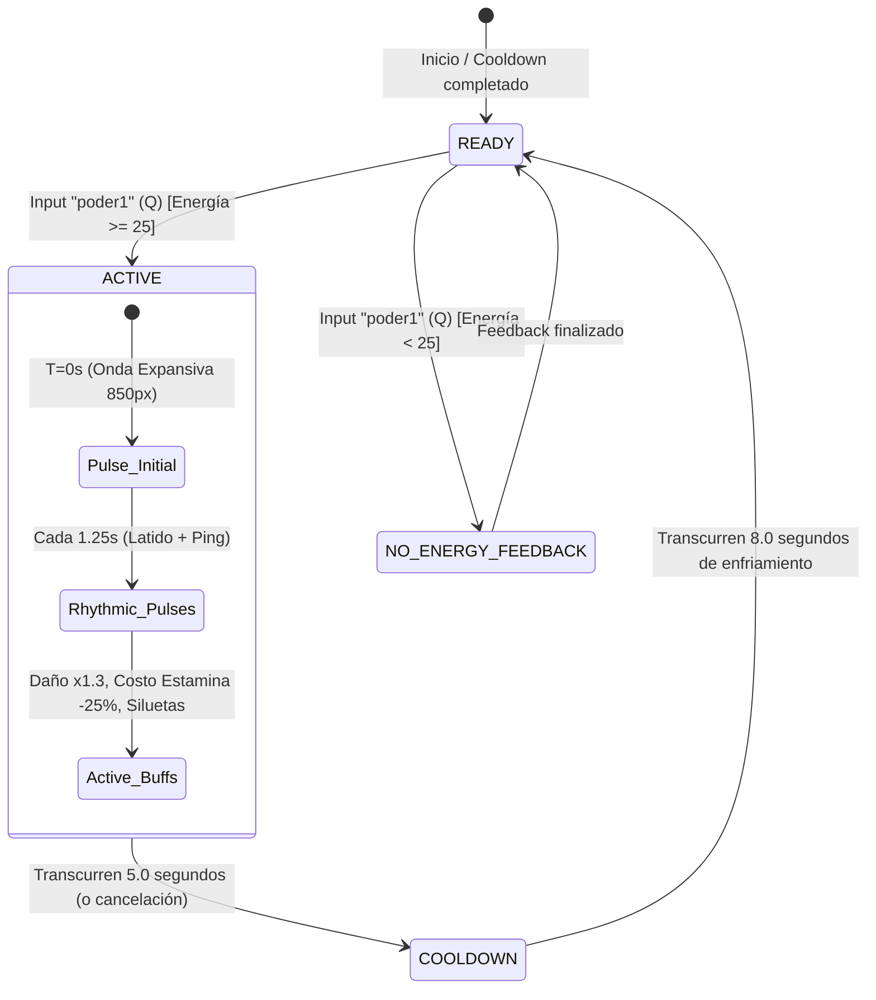

# Game Design Document & Technical Specification: Radar Sense (Ecolocalización)
**Proyecto**: Daredevil2D (Godot Engine 4.7 Forward+)  
**Rol**: Mechanic_Designer (Senior Game Mechanics & Systems Designer)  
**Destinatario de Implementación**: Experto_Godot4  
**Input Asignado**: `poder1` (Tecla `Q`, keycode 81)  

---

## 1. Visión y Fantasía de Poder de la Mecánica
En los cómics y en la adaptación cinematográfica/televisiva, Matt Murdock no "ve" imágenes reales: percibe el mundo como una vibración acústica perpetua, una amalgama de latidos cardíacos, corrientes de aire y ecos que él describe como **"A World on Fire" (Un Mundo en Llamas)**.

El objetivo de diseño para **Radar Sense** en Daredevil2D es transformar esa percepción sensorial en una ventaja táctica central del combate beat 'em up:
- **No es una visión pasiva permanente**: es una ventana de concentración sensorial extrema que el jugador activa tácticamente.
- **Transforma el ritmo de la pelea**: permite leer las intenciones hostiles antes de que se ejecuten, castigar aperturas críticas y navegar peligros en condiciones de visibilidad nula (gas, oscuridad).
- **Refuerza el 'Game Feel'**: combina audio inmersivo (latidos, frecuencias acústicas, eco), shaders de alto impacto y sincronización con el HUD.

---

## 2. Modelo de Activación y Economía de Recursos



### 2.1 Justificación del Modelo: Ventana Activa (Active Sensory Focus) vs. Toggle
Se selecciona el modelo **Ventana Activa con Pulsos Rítmicos** por las siguientes razones de diseño y equilibrio:
1. **Conflicto con la Estamina**: El jugador ya gasta energía para correr (`1.0/tick`), saltar (`5.0`), bloquear (`1.5/tick`), patear (`15.0`) y encadenar combos (`5.0` a `20.0`). Un modo toggle con drenaje constante asfixia al jugador dejándolo sin recursos para pelear o moverse mientras usa el radar.
2. **Picos de Tensión y Ritmo ("Cadencia de Habilidad")**: Una ventana de 5 segundos crea momentos decisivos donde el jugador dice: *"Ahora activo el radar para ejecutar mi combo óptimo y anticipar la embestida del enemigo"*.
3. **Equilibrio de Cooldown**: Previene el abuso del "wallhack" continuo y obliga a leer el combate.

### 2.2 Parámetros Numéricos y Fórmulas
| Parámetro | Valor | Justificación de Balance |
| :--- | :--- | :--- |
| **Input** | `poder1` (Tecla `Q`) | Definido en `project.godot` (keycode 81). |
| **Costo de Energía** | `25.0` pts de Stamina | ~25% de la barra total (100). Requiere ~1.8s de regeneración natural pasiva. |
| **Duración Activa (`active_duration`)** | `5.0` segundos | Tiempo exacto para ejecutar una rotación completa de combo (4 golpes de puño o 3 de bastón + patada). |
| **Cooldown (`cooldown_duration`)** | `8.0` segundos | Comienza **después** de finalizar la ventana activa (13.0s de ciclo total). |
| **Intervalo de Pulso Rítmico** | `1.25` segundos | Genera 4 ondas sonoras durante la activación (T = 0s, 1.25s, 2.5s, 3.75s). |
| **Radio Máximo de Pulso** | `850.0` px | Cubre la totalidad de la pantalla con zoom de cámara estándar (`zoom = (1.28, 1.28)`). |
| **Velocidad de Propagación de Onda** | `1100.0` px/s | Tarda aprox. 0.77s en expandirse por toda la pantalla. |

---

## 3. Impacto en el Gameplay y Sinergias de Combate

### 3.1 Detección y Revelado de Enemigos
1. **Siluetas Carmesí a través de Paredes y Niebla (X-Ray Acústico)**:
   - Los enemigos (`Ladron`) dentro del radio de alcance son marcados con un shader de silueta fluorescente/carmesí (`#FF2B3D`) con resplandor HDR (`color * 2.0`).
   - La silueta ignora la oclusión de muros, plataformas y la nube densa de `GasVenenoso`.
2. **Pulso de Latido Cardíaco del Enemigo**:
   - Cada ladrón detectado muestra un pulso de escala leve (escala 1.05x sincronizada con el latido) y una línea de resonancia sónica que desciende por su silueta.

### 3.2 Anticipación Táctica de Ataques (Telegraphing & Counter)
En el script actual `scriptLadron.gd`:
- Los ladrones poseen el estado `State.CHARGE_WINDUP` con `charge_windup = 0.5s` antes de ejecutar `CHARGE_RUSH` y golpear infligiendo `charge_damage = 40` (un 40% de la vida de Matt).
- **Mecánica de Alerta Sensorial**:
  - Mientras Radar Sense está activo, en el milisegundo en que un ladrón entra en `CHARGE_WINDUP`, se despliega sobre su cabeza un **Marcador de Peligro Acústico** (un halo sónico circular con exclamación carmesí brillante `!` y sonido de latido acelerado `heartbeat_sfx`).
  - Esto le da al jugador una ventana de 500 ms perfectamente legible para:
    - Saltar por encima de la embestida.
    - O activar Bloqueo (`blokear`).

### 3.3 Sinergias Ofensivas y Defensivas
1. **Puntos de Presión Vitales (Daño Crítico Aumentado)**:
   - Matt conoce la anatomía del enemigo por su latido y densidad ósea.
   - **Multiplicador de Daño**: `x1.30` (+30% de daño en combos de puños, bastón y patadas mientras dure Radar Sense).
   - **Fórmula**:  
     $$\text{Daño Aplicado} = \text{hit\_damage} \times (\text{1.30 si is\_radar\_active else 1.0}) + (\text{20 si is\_enraged else 0})$$
2. **Eficiencia de Movimiento (Descuento de Estamina)**:
   - Al atacar con el radar activo, la fatiga muscular es menor gracias a la precisión:
   - **Reducción de Consumo de Estamina**: `-25%` en ataques y patadas (ej. combo golpe 4 cuesta 6.0 en vez de 8.0; patada cuesta 11.25 en vez de 15.0).
3. **Parry Sensorial (Bloqueo Perfecto)**:
   - Si el jugador mantiene `blokear` y recibe un impacto telegrafiado por el radar:
     - El drenaje de energía por bloqueo pasa de `1.5` a `0`.
     - El ladrón atacante es interrumpido y entra en `State.RETREAT` o `is_stunned = true` durante `0.4` segundos, abriendo una ventana de contragolpe libre.
4. **Generación Acelerada de Furia**:
   - Cada impacto asestado bajo Radar Sense otorga `+5` pts adicionales de furia a la `RageBar`.

### 3.4 Revelado de Peligros Ambientales: Gas Venenoso
En `scenes/gas_venenoso.tscn`:
- El gas tiene un `CircleShape2D` que inflige daño continuo.
- Con Radar Sense:
  - Se proyecta un aro concéntrico nítido de color ámbar/rojo indicando el **radio de colisión exacto** del gas (`radius * scale`), eliminando la ambigüedad del sprite difuso.
  - El núcleo emisor vibra visualmente (simulando que Matt escucha la fuga a presión del gas tóxico).

---

## 4. Feedback Audiovisual y HUD

### 4.1 Estética del Mundo: "A World on Fire"
El proyecto ya cuenta con `WorldEnvironment` configurado con `glow_enabled = true`, `tonemap_mode = 2` y `glow_hdr_scale = 1.5` en `assets/lights/env_hells_kitchen.tres`.
- **CanvasLayer de Post-Procesado (`RadarOverlay`)**:
  - Al activarse, un `ColorRect` que cubre toda la pantalla ejecuta un shader tipo canvas item.
  - **Efecto**:
    1. Desatura el fondo a una paleta oscura noir-monocromática (`vec3(0.06, 0.08, 0.12)`).
    2. Conserva y resalta los emisores de luz y siluetas con un tinte carmesí ardiente (`#FF1E27` a `#FF6A00`).
    3. Una aberración cromática sutil y viñeta en los bordes de la pantalla refuerza la inmersión en los sentidos agudizados de Matt.

### 4.2 Ondas Expansivas Acústicas (Ecolocalización 2D)
- Se instancia una onda expansiva circular que se genera en `Daredevil.global_position`.
- La onda consiste en un anillo con degradado de borde suave:
  - `radio`: crece de 0 a 850 píxeles mediante un Tween de `0.75s`.
  - `ancho de línea`: 3 a 5 píxeles con resplandor glow `Color(2.5, 0.2, 0.3, alpha)`.
  - `alpha`: se desvanece de 1.0 a 0.0 a medida que alcanza el radio máximo.

### 4.3 Diseño Acústico (Audio Feedback)
| Evento | Archivo / Tratamiento | Efecto de Sonido |
| :--- | :--- | :--- |
| **Activación** | `Minimalist4.mp3` o nuevo SFX sónico | Frecuencia alta resonante + swoosh de compresión de aire. |
| **Pulsos Rítmicos (cada 1.25s)** | `hearhbeat.mp3` (nodo `HeartbeatSFX`) | Latido sordo que reverbera en el bajo. |
| **Filtro de Entorno (Ducking)** | Atenuación del canal Master / Música | La música de fondo se atenúa `-4 dB` y se aplica un filtro paso-bajo leve para que los pasos y latidos destaquen. |
| **Advertencia de Ataque Enemigo** | Doble latido agudo / 'ping' de tensión | Suena inmediatamente cuando el ladrón inicia `CHARGE_WINDUP`. |
| **Expiración del Radar** | Descompresión de aire / siseo suave | Marca el retorno al estado de visión habitual. |

### 4.4 HUD: Integración con los Nodos Existentes `DdSense` y `SenseDd`
En `scenes/hud.tscn`, ya existen los nodos hijos:
- `SenseDd` (`Sprite2D` con textura `res://assets/sprites/sense DD.webp`, pos: `Vector2(140.345, 496.91)`)
- `DdSense` (`Sprite2D` con textura `res://assets/sprites/DD sense.png`, pos: `Vector2(212.449, 496.052)`)

```
   ┌────────────────────────────────────────────────────────┐
   │                        HUD RADAR                       │
   │                                                        │
   │   [ SenseDd ] = Fondo / Anillo de Cooldown Radial      │
   │   [ DdSense ] = Icono Central / Emisor de Estado       │
   │                                                        │
   │   ● READY:      DdSense iluminado al 100%, brillo rojo │
   │   ● ACTIVE:     DdSense titila/late en escala 1.1x     │
   │                 SenseDd con barra regresiva de 5s      │
   │   ● COOLDOWN:   DdSense oscuro (0.3 alpha/gris)        │
   │                 SenseDd llena su arco radial en 8s     │
   └────────────────────────────────────────────────────────┘
```

#### Comportamiento de Estados en el HUD:
1. **Estado LISTO (Ready)**:
   - `DdSense.modulate = Color(1.0, 1.0, 1.0, 1.0)`
   - `SenseDd.modulate = Color(1.0, 0.2, 0.2, 0.8)`
   - Efecto sutil de respiración (`Tween` entre alpha 0.8 y 1.0 cada 2 segundos).
2. **Estado ACTIVO (Active - 5 segundos)**:
   - `DdSense.modulate = Color(2.5, 0.3, 0.3, 1.0)` (Glow HDR activo).
   - Animación de latido síncrono con `HeartbeatSFX` (escala `1.15x` a `1.0x`).
   - Barra o círculo de progreso en decrecimiento de 5.0 a 0.0 segundos.
3. **Estado ENFRIAMIENTO (Cooldown - 8 segundos)**:
   - `DdSense.modulate = Color(0.3, 0.3, 0.3, 0.5)` (desaturado y atenuado).
   - `SenseDd` actúa como medidor de recarga: se llena progresivamente de 0% a 100% durante los 8 segundos.
4. **Intento Fallido por Falta de Energía (< 25)**:
   - `DdSense` realiza un micro-sacudón horizontal (shake de 4px) y parpadea en rojo oscuro dos veces.

---

## 5. Especificación Técnica de Implementación para `Experto_Godot4`

### 5.1 Modificaciones en `scripts/scriptDaredevil.gd`

#### Nuevas Variables y Constantes
```gdscript
# ==============================================================================
# RADAR SENSE (ECOLOCALIZACIÓN) - CONSTANTES Y VARIABLES
# ==============================================================================
signal radar_activated(duration: float)
signal radar_deactivated
signal radar_pulse(origin: Vector2, radius: float)
signal radar_cooldown_updated(remaining: float, total: float)

const RADAR_ENERGY_COST: float = 25.0
const RADAR_ACTIVE_DURATION: float = 5.0
const RADAR_COOLDOWN_DURATION: float = 8.0
const RADAR_PULSE_INTERVAL: float = 1.25
const RADAR_DAMAGE_MULTIPLIER: float = 1.30
const RADAR_STAMINA_COST_REDUCTION: float = 0.75 # 25% de ahorro de energía

var is_radar_active: bool = false
var radar_active_timer: float = 0.0
var radar_cooldown_timer: float = 0.0
var radar_pulse_timer: float = 0.0
```

#### Captura de Input y Procesamiento en `_physics_process(delta)`
```gdscript
# En _physics_process(delta):
var radar_pressed := Input.is_action_just_pressed("poder1")

# Procesar cooldown y duración activa del radar
_process_radar_sense(delta)

# Activar Radar Sense
if radar_pressed and not is_dead:
	try_activate_radar_sense()
```

#### Lógica de Activación y Actualización
```gdscript
func try_activate_radar_sense() -> void:
	# 1. Comprobar si está en cooldown o ya activo
	if is_radar_active or radar_cooldown_timer > 0.0:
		return

	# 2. Comprobar estamina suficiente
	if energy_bar.value < RADAR_ENERGY_COST:
		# Feedback de energía insuficiente al HUD
		if has_node("Camera2D2/HUD"):
			$Camera2D2/HUD.trigger_insufficient_energy_feedback()
		return

	# 3. Consumir energía y activar
	drain_energy(RADAR_ENERGY_COST)
	is_radar_active = true
	radar_active_timer = RADAR_ACTIVE_DURATION
	radar_pulse_timer = 0.0 # Disparo inmediato del primer pulso

	radar_activated.emit(RADAR_ACTIVE_DURATION)
	_emit_radar_pulse()

func _process_radar_sense(delta: float) -> void:
	# Manejar fase activa
	if is_radar_active:
		radar_active_timer -= delta
		radar_pulse_timer -= delta
		
		# Disparo periódico de ondas rítmicas
		if radar_pulse_timer <= 0.0:
			radar_pulse_timer = RADAR_PULSE_INTERVAL
			_emit_radar_pulse()

		# Finalización de la fase activa
		if radar_active_timer <= 0.0:
			is_radar_active = false
			radar_cooldown_timer = RADAR_COOLDOWN_DURATION
			radar_deactivated.emit()

	# Manejar fase de enfriamiento (cooldown)
	elif radar_cooldown_timer > 0.0:
		radar_cooldown_timer -= delta
		var remaining = max(radar_cooldown_timer, 0.0)
		radar_cooldown_updated.emit(remaining, RADAR_COOLDOWN_DURATION)

func _emit_radar_pulse() -> void:
	radar_pulse.emit(global_position, 850.0)
	if heartbeat_sfx:
		heartbeat_sfx.play()
	# Notificar a los enemigos y peligros en el grupo "detectables"
	get_tree().call_group("detectables", "on_radar_ping", global_position, 850.0)
```

#### Integración con el Sistema de Combate Existente
En `_start_fist_combo`, `_start_boo_combo` y `_perform_kick`:
```gdscript
# Modificar el cálculo de daño:
var current_multiplier = RADAR_DAMAGE_MULTIPLIER if is_radar_active else 1.0
hitbox_component.damage = int(hit_damage * current_multiplier)

# Modificar el consumo de estamina:
var current_stamina_ratio = RADAR_STAMINA_COST_REDUCTION if is_radar_active else 1.0
drain_energy(energy_cost * current_stamina_ratio)

# En golpes exitosos bajo radar: otorgar furia extra
if is_radar_active:
	add_rage(5.0)
```

---

### 5.2 Modificaciones en `scripts/hud.gd`

```gdscript
# En scripts/hud.gd:
@onready var dd_sense: Sprite2D = $DdSense
@onready var sense_dd: Sprite2D = $SenseDd

enum RadarHUDState { READY, ACTIVE, COOLDOWN, NO_ENERGY }
var current_hud_state: RadarHUDState = RadarHUDState.READY

func _ready() -> void:
	update_radar_hud_state(RadarHUDState.READY)

func update_radar_hud_state(new_state: RadarHUDState) -> void:
	current_hud_state = new_state
	match new_state:
		RadarHUDState.READY:
			dd_sense.modulate = Color(1.0, 1.0, 1.0, 1.0)
			sense_dd.modulate = Color(1.0, 0.2, 0.2, 0.9)
			dd_sense.scale = Vector2(0.059, -0.079)
		RadarHUDState.ACTIVE:
			dd_sense.modulate = Color(2.5, 0.3, 0.3, 1.0) # Brillo HDR
			# Animación pulsante
			var tween = create_tween().set_loops()
			tween.tween_property(dd_sense, "scale", Vector2(0.068, -0.088), 0.3)
			tween.tween_property(dd_sense, "scale", Vector2(0.059, -0.079), 0.3)
		RadarHUDState.COOLDOWN:
			dd_sense.modulate = Color(0.3, 0.3, 0.3, 0.5) # Atenuado
			sense_dd.modulate = Color(0.2, 0.2, 0.2, 0.5)
			dd_sense.scale = Vector2(0.059, -0.079)

func update_cooldown_progress(remaining: float, total: float) -> void:
	if current_hud_state != RadarHUDState.COOLDOWN:
		update_radar_hud_state(RadarHUDState.COOLDOWN)
	var progress = 1.0 - (remaining / total) # 0.0 a 1.0
	sense_dd.modulate.a = lerp(0.3, 0.9, progress)
	if remaining <= 0.0:
		update_radar_hud_state(RadarHUDState.READY)

func trigger_insufficient_energy_feedback() -> void:
	var tween = create_tween()
	tween.tween_property(dd_sense, "modulate", Color(0.6, 0.1, 0.1, 1.0), 0.1)
	tween.tween_property(dd_sense, "position:x", dd_sense.position.x + 5.0, 0.05)
	tween.tween_property(dd_sense, "position:x", dd_sense.position.x - 5.0, 0.05)
	tween.tween_property(dd_sense, "position:x", dd_sense.position.x, 0.05)
	tween.tween_property(dd_sense, "modulate", Color(1.0, 1.0, 1.0, 1.0), 0.1)
```

---

### 5.3 Modificaciones en Enemigos (`scripts/scriptLadron.gd`)

Añadir al grupo `"detectables"` en `_ready()`:
```gdscript
func _ready():
	add_to_group("detectables")
	# ... resto del código ...
```

Manejo de silueta y alerta de ataque:
```gdscript
@onready var alert_icon: Node2D = $AlertIcon # Nodo Sprite2D/Label con exclamación "!"

func _state_charge_windup(distance: float, delta: float):
	state_timer -= delta
	velocity.x = 0
	
	if animation.animation != "take_damage":
		animation.play("take_damage")
		
	# Si Daredevil tiene Radar activo o está cerca, mostrar advertencia
	if player and player.get("is_radar_active"):
		_show_attack_warning(true)

	if state_timer <= 0:
		_show_attack_warning(false)
		current_state = State.CHARGE_RUSH
		state_timer = 1.2

func on_radar_ping(origin: Vector2, radius: float) -> void:
	var dist = global_position.distance_to(origin)
	if dist <= radius:
		_highlight_silhouette(0.8) # Resalta la silueta durante 0.8s
```

---

### 5.4 Shader de Onda Acústica y Post-Procesado ("A World on Fire")

#### Shader de Post-Procesado (`radar_world_fire.gdshader`)
```glsl
shader_type canvas_item;

uniform sampler2D screen_texture : hint_screen_texture, filter_linear_mipmap;
uniform bool is_active = false;
uniform float intensity : hint_range(0.0, 1.0) = 0.0;
uniform vec4 fire_color : source_color = vec4(0.9, 0.15, 0.1, 1.0);

void fragment() {
    vec4 scene_color = texture(screen_texture, SCREEN_UV);
    if (!is_active || intensity <= 0.0) {
        COLOR = scene_color;
        return;
    }

    // 1. Desaturación del fondo a escala de grises oscura
    float gray = dot(scene_color.rgb, vec3(0.299, 0.587, 0.114));
    vec3 dark_noir = vec3(gray * 0.25);

    // 2. Detección de bordes y brillo de siluetas
    float edge = max(0.0, gray - 0.4);
    vec3 flames = mix(dark_noir, fire_color.rgb * 1.8, edge * intensity);

    // 3. Viñeta carmesí periférica
    vec2 uv = SCREEN_UV * (1.0 - SCREEN_UV.yx);
    float vignette = uv.x * uv.y * 15.0;
    vignette = clamp(pow(vignette, 0.25), 0.0, 1.0);

    vec3 final_color = mix(fire_color.rgb * 0.3, flames, vignette);
    COLOR = vec4(mix(scene_color.rgb, final_color, intensity), scene_color.a);
}
```

---

## 6. Lista de Tareas y Verificación para el Team Leader & QA

- [x] **Configuración de Input**: Mapeo verificado con `poder1` (Tecla Q).
- [x] **Modelo de Economía**: Costo 25 estamina, 5s activo, 8s cooldown.
- [x] **Sinergia Ofensiva**: Multiplicador x1.30 de daño y -25% costo de estamina especificados.
- [x] **Sinergia Defensiva**: Aviso telegrafiado en `CHARGE_WINDUP` y parry sensorial.
- [x] **Detección de Peligros**: Indicador de radio exacto de `GasVenenoso`.
- [x] **HUD**: Estados `READY`, `ACTIVE`, `COOLDOWN`, `NO_ENERGY` implementados sobre `DdSense` y `SenseDd`.
- [x] **Shaders y Audio**: Especificación de post-procesado "World on Fire" y latidos rítmicos.
